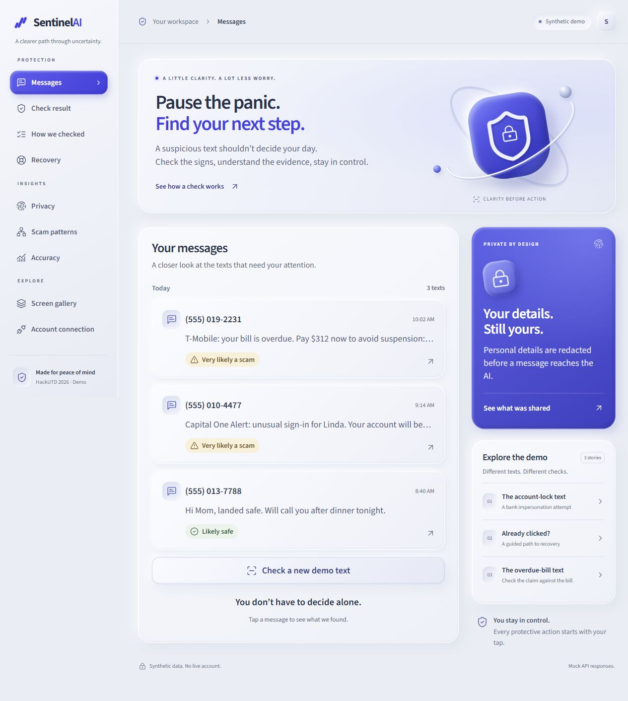

# SentinelAI: silver clay workspace

User-requested frontend refresh, issue #73. The reference images inform the palette only; no reference image is bundled, embedded, or requested at runtime.

[Mobile preview at 390px](design/mobile.jpg)

## Visual system

- Silver canvas `#e9edf5`, cool white surfaces `#f9faff`, graphite text `#26324b`, cobalt controls `#353be6`.
- Raised panels combine a pale top edge, soft outer shadows, and subtle inner shading. Message previews and small controls use recessed surfaces.
- The shield and lock illustrations use CSS gradients and existing Lucide icons. No new imagery, packages, remote font calls, or services.
- Source Sans 3 remains bundled locally. Main content stays at 18px; metadata and navigation use a smaller supporting scale.
- Amber remains caution, gray remains uncertainty, and green remains likely safe. Verdicts continue to use words, with percentages confined to accuracy.

## Layout and navigation

The user requested a website experience, so the primary routes now sit in a responsive desktop workspace rather than inside a fixed phone mockup. The gallery retains the phone frames for reviewing all existing states.

The sidebar groups all nine destinations into Protection, Insights, and Explore. Message-specific links preserve the current message ID across result, evidence, privacy, and recovery. On general pages, these links open the first authored demo scenario. The demo stories remain clearly labeled as synthetic data.

At desktop sizes, the content panel sits beside privacy and scenario tiles. Below 1050px, supporting tiles move underneath. Below 760px, a labeled disclosure menu replaces the fixed rail. Opening the menu focuses its first destination; Escape closes it and restores focus to the toggle; selecting a destination moves focus to the main content.

No API schemas, polling behavior, protective actions, or consent behavior changed. The workspace uses the existing routes and view components. Account connection opens the existing consent screen.

## Implementation

`frontend/src/theme.css` retains the shared component layout and semantic colors. `frontend/src/workspace.css` defines the workspace and clay treatments, imported after the base theme. `App.tsx` owns the responsive shell and route-aware navigation. `App.test.tsx` verifies navigation context, all destinations, menu focus, and synthetic labeling.

## Local preview

In the design worktree, `.env` uses `WEB_PORT=5185`, `API_PORT=8015`, `USE_MOCKS=true`, and `DEMO_MODE=replay`. These are preview settings only and are not committed. Start the existing Vite and FastAPI commands in separate PowerShell terminals, then visit `http://127.0.0.1:5185/inbox`. This preview uses synthetic API fixtures; it does not demonstrate live integration results.

## Verification

68 frontend tests and the production build pass; 688 backend tests pass (external credentials cleared in the test child process). Browser review covers the inbox, result, privacy, recovery transition, expanded campaign cards, accuracy table, and filtered screen gallery at 1280px and 390px. The inbox and gallery were also checked at 320px without page-level horizontal overflow. No browser console errors were observed. No deployment is part of this design change.

To repeat: run `npm test` and `npm run build` from `frontend/`, and `python -m pytest -q` from `backend/`.
