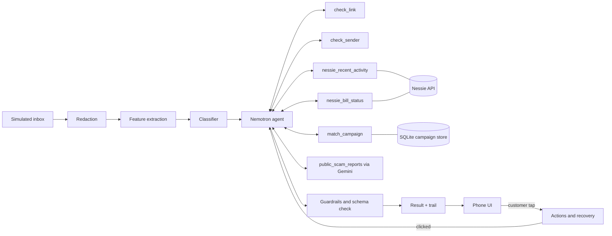

# SentinelAI: POC and MVP Plan

HackUTD 2026 · Arnav and Lavanya · Tracks: T-Mobile, NVIDIA (Nemotron), Capital One (Nessie), plus HackUTD Best Design and General

This is the build's source of truth. If another document disagrees with this one, this one wins. Data contracts live in [DATA_SPEC.md](DATA_SPEC.md).

---

## 1. The product in one paragraph

SentinelAI is a scam protection agent for phone and bank customers. When a suspicious text arrives, it redacts personal details, classifies the message, and hands it to a Nemotron agent. The agent plans its own checks: the link, the sender, known scam campaigns, the customer's real account activity and bills through Capital One's Nessie API, and public scam reports through Gemini. The customer sees one calm result card: a verdict in words, an honest confidence level, a one-sentence reason, and at most three actions. Nothing happens until the customer taps. If they already clicked, the agent switches to recovery: it finds activity they may not have made, asks "Was this you?", and gives a checklist.

**Demo customer:** Linda, 67, has a Capital One checking account and credit card and pays her T-Mobile bill on autopay.

**One-line pitch:** "Scammers win because people have to guess, alone and in a panic, whether a message is real. SentinelAI checks the message and the money together, and tells you exactly what to do."

---

## 2. What each track's judges must see

| Track | Judged on | The moment that wins it | Where in the demo |
| --- | --- | --- | --- |
| T-Mobile | Creativity, impact, usability, security and privacy, detection accuracy | Accuracy by category against their baseline, including the false positive rate. The result card with honest confidence. The privacy panel. | Accuracy page, then scenario 1 |
| NVIDIA | Nemotron doing multi-step, tool-using work with real-world use | Two messages produce two different plans. A tool result changes the plan partway through. The "How we checked" trail shows Nemotron deciding. | Scenarios 1 and 3 side by side, scenario 2 re-plan |
| Capital One | Creative use of Nessie's accounts, bills, transfers and merchants | Nessie answers the scam's claim ("your T-Mobile bill was paid on Nov 1"). Recovery mode finds the planted $900 transfer and asks "Was this you?" | Scenarios 2 and 3 |
| Best Design | Visual and interaction design | A calm phone UI built for a stressed, older user: large type, words instead of percentages, one clear next step | Every screen |

---

## 3. POC: prove the risky parts first

The POC answers five questions before we build the product. Each gate has a pass test and a pivot if it fails. **Target: all five by hour 6.**

| Gate | Question | Pass test | If it fails |
| --- | --- | --- | --- |
| P1 | How good is T-Mobile's baseline on our held-out split? | `eval/baseline_metrics.json` exists with precision, recall, F1 per category and the false positive rate | Not a failure. If baseline macro F1 is 0.97 or higher, the accuracy story becomes "fewer false alarms and better on the weakest categories" |
| P2 | Does Nemotron call our tools reliably? | 5 of 5 fixed test inputs return native tool calls and a final answer that passes schema validation | Switch to the JSON action protocol (section 7.3). Code dispatches the tools. |
| P3 | Does Gemini grounded search return cited sources? | The demo query returns at least one source URL in the grounding metadata, in our JSON shape | Gemini becomes the second item in the cut order (section 11) |
| P4 | Can we seed and read Nessie? | The seed script creates Linda's customer, accounts, purchases, the paid T-Mobile bill and the "unknown payee" account, and reads them back. Running it twice creates nothing new. | Use a local fixture that mirrors Nessie's schema, served through the replay cache |
| P5 | Does redaction work? | Unit tests pass on 20 hand-written strings covering names, phone numbers, account digits, addresses and emails | Fix the regexes. The named-entity model is optional; regex alone is acceptable. |

**POC exit:** P1 to P5 pass, or each failure has taken its pivot.

**First MVP gate (G1, by hour 14):** scenario 1 runs end to end from the command line: `python -m scripts.run_scenario 1` prints the trail and a schema-valid verdict. Scenarios 2 and 3 don't start until G1 passes.

---

## 4. MVP scope

### 4.1 In scope

1. Simulated phone inbox fed from the T-Mobile message set plus three scenario messages
2. Redaction before anything else sees the message
3. Improved classifier that returns a taxonomy category and a score, evaluated against the baseline
4. Nemotron agent with six tools, a visible plan, re-planning, and code-enforced guardrails
5. Nessie checks: recent activity and bill status, plus recovery mode
6. Gemini public-report lookup with cited sources
7. Campaign grouping with anonymized fingerprints
8. Phone UI: consent, inbox, result card, "How we checked", privacy panel, recovery, campaign view
9. Accuracy page for judges (outside the phone frame)
10. Record and replay mode so the demo runs without live APIs

### 4.2 Out of scope

Real SMS integration, real bank data, user accounts and login, Docker, Postgres, vector databases, graph databases, Triton, NeMo fine-tuning, WebSockets (we poll), mobile native apps.

### 4.3 The three scenarios

| # | Message | Expected plan | Customer sees | Proves |
| --- | --- | --- | --- | --- |
| 1 | "Capital One Alert: unusual sign-in. Your account will be locked in 2 hours. Verify now: [link]" | `check_link`, `check_sender`, then `nessie_recent_activity` because the sender claims to be Linda's bank | "Very likely a scam. We found no unusual activity on your Capital One account in the last 7 days. Capital One doesn't ask you to verify by text link." | T-Mobile, NVIDIA, Capital One |
| 2 | Same message. Linda taps "I clicked and entered my info" | Re-plan: `nessie_recent_activity` since the message arrived. Finds a new $900 transfer to an unknown payee. | "Was this you?" for the transfer, then a recovery checklist: freeze card, change password, call the number on your card | Capital One, NVIDIA re-plan |
| 3 | "T-Mobile: your bill is overdue. Pay $312 now to avoid suspension: [link]" | `match_campaign`, `nessie_bill_status` for payee "T-Mobile", `public_scam_reports`. Skips the account activity check. | "This is part of a fake billing campaign. Your T-Mobile bill was paid on [date]." Plus cited public reports. | NVIDIA (different plan), Capital One, T-Mobile creativity |

Use messages from the T-Mobile set when close matches exist. Otherwise write them in the same style and label them as authored. Amounts, dates and campaign counts in the UI come from the real seeded data and runs, never hardcoded.

### 4.4 Wording rules (honest confidence)

- Verdicts: `likely_scam`, `unsure`, `likely_safe`. Shown as "Very likely a scam", "We're not sure", "Likely safe".
- Never say "your account is fine" or "this is safe". Say what was checked: "We found no unusual activity in the last 7 days."
- No percentages in the phone UI. Percentages appear only on the accuracy page.
- When evidence is mixed, say so: "Some signs point to a scam, but we couldn't confirm it."
- Contact steps always say "call the number on the back of your card" or "use the official app". Never show a phone number or link found by search or written by the model.

---

## 5. Architecture



**Data boundaries:** only redacted text reaches the classifier and Nemotron. Only the Nessie tools touch account data, and they return summaries with references, not raw records. Gemini receives only brand, category, domain and a generic lure phrase. Every external call goes through the record and replay cache.

---

## 6. Repository layout

```
backend/
  app/
    main.py              FastAPI app and routes
    config.py            env settings
    contracts.py         Pydantic models shared by every module (see DATA_SPEC.md)
    pipeline.py          message -> redact -> features -> classify -> agent -> result
    privacy/redact.py
    features/extract.py
    classifier/          baseline.py, train.py, predict.py
    agent/               loop.py, prompts.py, registry.py, guardrails.py
    tools/               link.py, sender.py, campaign.py, nessie_tools.py, public_reports.py
    integrations/        nemotron.py, gemini.py, nessie.py, cache.py
  scripts/               seed_nessie.py, run_baseline.py, train_classifier.py, evaluate.py, run_scenario.py
  tests/
frontend/                Vite + React + TypeScript + Tailwind
  src/api.ts, src/types.ts, src/screens/*
data/
  raw/                   T-Mobile files (gitignored unless the sponsor allows committing them)
  brands.json            official domains and channels for demo brands
  scenarios/             the three scenario messages
  fixtures/              replay cache
eval/                    metrics JSON written by scripts
docs/                    this file, DATA_SPEC.md
prompts/                 Claude Code prompts
```

---

## 7. Backend design

### 7.1 API

| Method and path | Purpose |
| --- | --- |
| `GET /api/inbox` | Messages in the demo inbox with their status |
| `POST /api/messages` | Simulate a message arriving `{text, sender, received_at}`. Returns `{message_id}` and starts the pipeline in the background. |
| `GET /api/messages/{id}/result` | `{status: queued, running or done, trail: [...], result?}`. The UI polls every second, so the trail fills in live. |
| `POST /api/messages/{id}/clicked` | Customer says they clicked. Starts the recovery re-plan. |
| `POST /api/transactions/{ref}/confirm` | `{was_me: true or false}` from the "Was this you?" prompt |
| `POST /api/actions` | `{message_id, action}`. Simulated block, report or alert. Only called after a tap. |
| `GET /api/privacy/{id}` | What was redacted and exactly what each tool and model received |
| `GET /api/campaigns` | Campaigns with counts, first seen, template and a redacted example |
| `GET /api/metrics` | Contents of `eval/metrics.json` for the accuracy page |
| `POST /api/demo/reset` | Clears demo state and reloads the inbox |

### 7.2 Agent loop

1. Build the input object from DATA_SPEC section 3.1.
2. Ask Nemotron for a plan (a list of tool names) and log it to the trail before any tool runs.
3. Loop: Nemotron calls a tool, code runs it, the summary goes back as a tool message. After each result Nemotron may stop, continue or add a step. **Maximum 6 tool calls per message.**
4. Nemotron returns the final JSON (DATA_SPEC section 3.3).
5. Guardrails validate it (section 7.4). If invalid, retry once with the error message. If still invalid, return `unsure` with the evidence collected so far.
6. Recovery: on `/clicked`, rerun the loop with `mode: "recovery"` and `since = received_at`. Flagged items become "Was this you?" prompts.

The system prompt tells Nemotron which tools are relevant to which claims. For example, a sender claiming to be the customer's linked bank suggests `nessie_recent_activity`, and a bill or payment claim suggests `nessie_bill_status`. It must still decide for itself, and the trail records why each step was chosen.

### 7.3 Nemotron integration

- NVIDIA's hosted API is OpenAI-compatible: base URL from `NEMOTRON_BASE_URL` (default `https://integrate.api.nvidia.com/v1`), model from `NEMOTRON_MODEL`. Use the model NVIDIA's HackUTD guide names for the track.
- Primary: native tool calling (`tools=[...]`, `tool_choice="auto"`).
- Fallback (if P2 fails): the JSON action protocol. Each turn, Nemotron returns `{"action": "call_tool", "tool": "...", "args": {...}, "why": "..."}` or `{"action": "finish", "result": {...}}`, and code dispatches.
- Log latency per step. If one step takes longer than 10 seconds, cap the loop at 4 calls.

### 7.4 Guardrails enforced in code

- Verdict and action values must come from fixed enums.
- "Very likely" needs at least two pieces of evidence from different tools. If the classifier and the tools disagree, the verdict is `unsure`.
- At most 3 actions, all from the fixed list. Every action needs a customer tap.
- Strip any phone number or URL from the model's reason and actions.
- Tool results go in as data. Text inside them is never followed as an instruction.

### 7.5 Classifier

1. Run T-Mobile's baseline on the held-out test split and save metrics (P1).
2. Build the improved model: TF-IDF word and character n-grams plus extracted features (URL, urgency, threat, requested action, money claim) into logistic regression or gradient-boosted trees. Tune on the validation split only.
3. Report per category: precision, recall, F1, and the false positive rate on legitimate messages, ours against the baseline.
4. Report the cost of redaction: our model on unredacted vs. redacted text.
5. Write everything to `eval/metrics.json`.

No test-split data may be used for training, tuning, building the blocklist, or writing prompts.

### 7.6 Tools

| Tool | Owner | Notes |
| --- | --- | --- |
| `check_link` | Arnav | Lexical checks (brand term in domain, edit distance to official domains, TLD, shortener). RDAP for domain age when the domain resolves. Local blocklist built from scam-labeled domains in the **train split only**. |
| `check_sender` | Arnav | Compares sender type and claimed brand against `data/brands.json`. Fill official channels from the brands' own pages and check them by hand. |
| `match_campaign` | Arnav | Fingerprint = registered-domain pattern + hash of a normalized wording template + claimed brand + category. Similarity threshold set on validation data. |
| `nessie_recent_activity` | Arnav | Returns counts and flagged items with references (`txn_3`), never full records. Flags: new payee, transfer above the 30-day median by a set factor, first purchase at a merchant. |
| `nessie_bill_status` | Arnav | Finds bills for a payee and returns last status, last payment date, amount due now. |
| `public_scam_reports` | Lavanya | Gemini with Google Search grounding. Four fixed questions, source ranking, cited JSON. See DATA_SPEC section 4. |

### 7.7 Nessie seed

- Customer "Linda" with a checking account and a credit card
- About 30 days of normal purchases at a handful of merchants
- A recurring T-Mobile bill marked completed with a recent payment date
- A second customer, "Unknown Payee", with one account to receive the planted transfer
- The planted $900 transfer from Linda's checking account to the unknown account, timed after scenario 2's message
- Seeded IDs saved to `data/nessie_seed.json`. The script is idempotent.

### 7.8 Record and replay

Every external call (Nemotron, Gemini, Nessie, RDAP) goes through `integrations/cache.py`. `DEMO_MODE=live` calls the API. `record` calls it and saves the response under `data/fixtures/`, keyed by a hash of the request. `replay` serves only saved responses. Record all three scenarios before the demo.

---

## 8. Frontend design

The phone frame is centered on a laptop screen. Judge-only pages (accuracy, campaigns overview) sit outside the frame.

| Screen | Contents |
| --- | --- |
| Consent | One-time screen: "Link your Capital One account so SentinelAI can check messages against your real activity." What we read, what we never store. Approve or skip. |
| Inbox | Message list. A new message shows "Checking…" and then a verdict chip. |
| Result card | Verdict in words, confidence in words, a one-sentence reason, at most 3 action buttons, an "I clicked this link" button |
| How we checked | Collapsible trail that fills in live: each step, what it found, why it ran |
| What we checked, what we never saw | Redacted fields, exactly what each model and tool received |
| Recovery | "Was this you?" card per flagged item (amount, payee, time), then a checklist with tick boxes |
| Campaign view | Campaign cards: count today, first seen, redacted template, linked messages |
| Accuracy page | Per-category table, ours vs. baseline, plus false positive rate and redaction cost |

**Design rules:** at least 18px body text and 44px tap targets. Calm palette: amber for "likely scam" instead of alarm red, gray for "not sure", green for "likely safe". Plain words, no jargon. One primary action per screen. Works on the projector at 1280 px wide.

---

## 9. Demo script (3 minutes)

| Time | Beat |
| --- | --- |
| 0:00 to 0:20 | Hook: Linda, 67, gets a text saying her bank account will be locked. |
| 0:20 to 0:40 | Accuracy page: our classifier against T-Mobile's baseline, by category, with false positives. |
| 0:40 to 1:20 | Scenario 1 live. The trail fills in, Nessie shows no unusual activity, the verdict appears, then the privacy panel. |
| 1:20 to 2:00 | Scenario 2. "I clicked." The agent re-plans, finds the $900 transfer, asks "Was this you?", then shows the checklist. |
| 2:00 to 2:40 | Scenario 3. A different plan with no account check. The bill was paid. Campaign of N messages, cited public reports. |
| 2:40 to 3:00 | Close: "Nemotron plans, Nessie checks the money, the customer decides." |

---

## 10. Build timeline

H0 is when both people start building after the scaffold and issues exist.

| Hours | Arnav | Lavanya |
| --- | --- | --- |
| H0 to H6 (POC) | A1 Nessie seed, A2 redaction, A3 replay cache, A4 phone shell on mock API | L1 baseline, L2 Nemotron smoke test, L3 Gemini smoke test |
| H6 to H10 | A5 link and sender tools, A7 Nessie tools | L4 features, L5 classifier, L6 agent loop |
| H10 to H14 | A8 result card and panels, G1 integration | L9 API and pipeline, G1 integration |
| H14 to H18 | A6 campaigns, A9 recovery UI, A10 consent and campaign view | L7 Gemini tool, L8 recovery re-plan, L10 accuracy page |
| H18 to H21 | G2 all scenarios, record fixtures, design polish | G2, eval report, Devpost |
| H21 to H24 | A11 backup video, Capital One and design pitch, G3 rehearsal | L11 NVIDIA and T-Mobile pitch, G3 rehearsal |

**Hard rule:** if G1 (scenario 1 end to end) isn't done by H14, follow the cut order.

---

## 11. Risks and cut order

| Risk | Mitigation |
| --- | --- |
| Baseline is already near perfect | Accuracy story shifts to false positives and weakest categories (P1 pivot) |
| Nemotron tool calling is unreliable | JSON action protocol (7.3) |
| An API is down or slow at demo time | Replay mode with recorded fixtures (7.8), plus a backup video |
| Nessie lacks a field we want (there is no "account locked" status) | Wording says what was checked (4.4) |
| Judge asks why T-Mobile can see a bank account | Consent screen: the customer links their own bank to an assistant on their side |
| Merge conflicts on shared files | `contracts.py` and `frontend/src/types.ts` change only through a PR both people see |

**Cut order (first to go):** 1. campaign view polish · 2. Gemini tool · 3. consent screen polish · 4. RDAP domain age. **Never cut:** scenario 3's bill check, the trail, the privacy panel, the accuracy table.

---

## 12. Issue breakdown

Claude Code creates exactly these issues (see `prompts/02-create-issues.md`). Titles start with the ID in brackets. Arnav's issues are assigned to `its-arnavtech`. Lavanya's are labeled `owner:lavanya` and left unassigned. Shared gates are labeled `owner:both` and assigned to `its-arnavtech`.

### Milestone: POC

| ID | Title | Owner | Depends on | Acceptance criteria |
| --- | --- | --- | --- | --- |
| L1 | Dataset loader, stratified split and baseline metrics | Lavanya | none | Loader maps T-Mobile fields to `contracts.Message`; 70/15/15 split saved with a fixed seed; `scripts/run_baseline.py` writes `eval/baseline_metrics.json` with per-category precision, recall, F1 and FPR |
| L2 | Nemotron client and tool-calling smoke test | Lavanya | none | `integrations/nemotron.py` reads model and URL from env; a test with 2 dummy tools passes on 5 of 5 inputs or the JSON action protocol is in place; latency logged (gate P2) |
| L3 | Gemini grounded search smoke test | Lavanya | none | `integrations/gemini.py` runs one grounded query and returns at least one cited URL in our JSON shape (gate P3) |
| A1 | Nessie client and idempotent seed script | Arnav | none | `integrations/nessie.py` and `scripts/seed_nessie.py` create everything in 7.7, save IDs to `data/nessie_seed.json`, and running twice creates nothing new (gate P4) |
| A2 | Redaction module | Arnav | none | `privacy/redact.py` returns redacted text plus a redaction report; 20 unit tests pass (gate P5) |
| A3 | Record and replay cache | Arnav | none | `integrations/cache.py` supports live, record and replay; used by Nemotron, Gemini, Nessie and RDAP clients |
| A4 | Phone shell, inbox and polling on the mock API | Arnav | scaffold | Phone frame, inbox list, "Checking…" state, polling `GET /api/messages/{id}/result` against the scaffold's mock responses |

### Milestone: MVP

| ID | Title | Owner | Depends on | Acceptance criteria |
| --- | --- | --- | --- | --- |
| G1 | Gate: scenario 1 end to end in the CLI | Both | A2, A5, A7, L4, L6 | `python -m scripts.run_scenario 1` prints the trail and a schema-valid verdict, using the baseline classifier if L5 isn't done |
| L4 | Feature extraction | Lavanya | A2 | `features/extract.py` returns the `urls` and `features` objects from DATA_SPEC 3.1; tested on 10 messages |
| L5 | Improved classifier and evaluation report | Lavanya | L1, L4 | Beats or matches the baseline on macro F1 without a worse FPR, or the P1 pivot is documented; `eval/metrics.json` has per-category rows and a redaction-cost row |
| L6 | Agent loop with plan, re-plan and guardrails | Lavanya | L2 | Implements 7.2 and 7.4; plan logged before tools run; max 6 calls; invalid output retried once then `unsure`; trail entries match DATA_SPEC |
| L7 | `public_scam_reports` tool | Lavanya | L3 | Implements DATA_SPEC section 4: fixed inputs, four questions, source ranking, stale flag, no phone numbers passed through |
| L8 | Recovery mode re-plan | Lavanya | L6, A7 | `/clicked` reruns the loop in recovery mode; scenario 2 finds the planted transfer and returns it as a "Was this you?" item |
| L9 | FastAPI endpoints and pipeline orchestration | Lavanya | L6 | All routes in 7.1 work against the real pipeline; background run with live trail updates |
| L10 | Accuracy page | Lavanya | L5, A4 | Judge-facing page reads `GET /api/metrics`; per-category table, FPR and redaction cost |
| A5 | `check_link` and `check_sender` tools | Arnav | A3 | Implements 7.6 rows 1 and 2; blocklist from the train split only; `data/brands.json` filled for the demo brands |
| A6 | Campaign store and `match_campaign` | Arnav | A2 | SQLite store of fingerprints only; seeded from the train split; scenario 3 matches a campaign with a real count |
| A7 | Nessie tools | Arnav | A1, A3 | `nessie_recent_activity` and `nessie_bill_status` return summaries with references, as in DATA_SPEC 3.2 |
| A8 | Result card, "How we checked" and privacy panel | Arnav | A4, L9 | Follows wording rules 4.4; trail fills in live; privacy panel reads `GET /api/privacy/{id}` |
| A9 | Recovery UI | Arnav | A8, L8 | "I clicked" button, "Was this you?" cards, checklist, every action behind a tap |
| A10 | Consent screen and campaign view | Arnav | A6, A8 | Consent screen as in section 8; campaign view reads `GET /api/campaigns` |
| G2 | Gate: all three scenarios end to end in the app | Both | all MVP issues | Each scenario runs in the UI in live mode and in replay mode |

### Milestone: Demo

| ID | Title | Owner | Depends on | Acceptance criteria |
| --- | --- | --- | --- | --- |
| L11 | NVIDIA and T-Mobile pitch, Devpost paragraphs | Lavanya | G2 | One Devpost paragraph per track naming its criteria and the demo moment; accuracy talking points |
| A11 | Replay fixtures, backup video, Capital One and design pitch | Arnav | G2 | Fixtures recorded for all three scenarios; a backup video under 3 minutes; Capital One and Best Design talking points |
| G3 | Rehearse the 3-minute demo three times | Both | L11, A11 | Three timed run-throughs in replay mode, each under 3:00 |

---

## 13. Definition of done

- [ ] The classifier beats or matches T-Mobile's baseline on held-out messages, shown by category with the false positive rate
- [ ] A new message triggers the Nemotron agent without anyone typing a prompt
- [ ] Two different messages produce two visibly different plans
- [ ] At least one tool result changes the plan partway through
- [ ] The agent calls Nessie and correctly reports no unusual activity, a paid bill, or the planted transfer
- [ ] Recovery mode finds the planted transfer and shows the "Was this you?" flow
- [ ] The result card shows verdict, confidence in words, a one-sentence reason and at most three actions
- [ ] The privacy panel shows what was redacted and what each tool received
- [ ] At least one campaign groups several similar messages
- [ ] Every protective action waits for the customer's tap
- [ ] All three scenarios run in replay mode with Wi-Fi off
- [ ] Devpost lists T-Mobile, Capital One, NVIDIA and Best Design, with one paragraph per track
