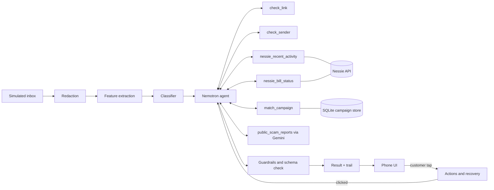

# SentinelAI: POC and MVP Plan

HackUTD 2026 · Arnav and Lavanya · Tracks: T-Mobile, NVIDIA (Nemotron), Capital One (Nessie), plus HackUTD Best Design and General

This is the build's source of truth. If another document disagrees with this one, this one wins. Data contracts live in [DATA_SPEC.md](DATA_SPEC.md). Rules for every coding agent live in [AGENTS.md](../AGENTS.md). Progress and handoffs live in [CHANGELOG.md](../CHANGELOG.md).

**Deadlines (from the opening ceremony):** initial Devpost submission by **11:00 PM Saturday**, final Devpost submission by **12:00 PM Sunday**, judging 1:00 to 4:00 PM Sunday. That is about 18 build hours.

**Data:** T-Mobile does not provide a message set, so we generate our own (issue A21) and validate on a public real-world SMS spam set (section 7.5).

**Who builds with what:** Arnav runs four agents: Claude Code (POCs, testing, data pipelines), Codex (Hugging Face and Nemotron connections on his laptop), Cursor (coding, backend engineering, infrastructure) and a second Codex session running GPT 6 Astra (frontend design). Lavanya runs Claude Code (core infrastructure plus the classifier, agent and Gemini work). Both Claude Code sessions use Opus 5.5. See section 12.

---

## 1. The product in one paragraph

SentinelAI is a scam protection agent for phone and bank customers. When a suspicious text arrives, it redacts personal details, classifies the message, and hands it to a Nemotron agent. The agent plans its own checks: the link, the sender, known scam campaigns, the customer's real account activity and bills through Capital One's Nessie API, and public scam reports through Gemini. The customer sees one calm result card: a verdict in words, an honest confidence level, a one-sentence reason, and at most three actions. Nothing happens until the customer taps. If they already clicked, the agent switches to recovery: it finds activity they may not have made, asks "Was this you?", and gives a checklist.

**Demo customer:** Linda, 67, has a Capital One checking account and credit card and pays her T-Mobile bill on autopay.

**One-line pitch:** "Scammers win because people have to guess, alone and in a panic, whether a message is real. SentinelAI checks the message and the money together, and tells you exactly what to do."

---

## 2. What each track's judges must see

| Track | Judged on | The moment that wins it | Where in the demo |
| --- | --- | --- | --- |
| T-Mobile | Creativity, impact, usability, security and privacy, detection accuracy | Accuracy by category against a simple baseline, on our held-out synthetic set and on real public SMS data, including the false positive rate. The result card with honest confidence. The privacy panel. | Accuracy page, then scenario 1 |
| NVIDIA | Nemotron doing multi-step, tool-using work with real-world use | Two messages produce two different plans. A tool result changes the plan partway through. The "How we checked" trail shows Nemotron deciding. | Scenarios 1 and 3 side by side, scenario 2 re-plan |
| Capital One | Creative use of Nessie's accounts, bills, transfers and merchants | Nessie answers the scam's claim ("your T-Mobile bill was paid on Nov 1"). Recovery mode finds the planted $900 transfer and asks "Was this you?" | Scenarios 2 and 3 |
| Best Design | Visual and interaction design | A calm phone UI built for a stressed, older user: large type, words instead of percentages, one clear next step | Every screen |

---

## 3. POC: prove the risky parts first

The POC answers five questions before we build the product. Each gate has a pass test and a pivot if it fails. **Target: all five by hour 6.**

| Gate | Question | Pass test | If it fails |
| --- | --- | --- | --- |
| P1 | Do we have a usable dataset and a baseline score? | The generated dataset (A21) passes its quality checks; `eval/baseline_metrics.json` exists with precision, recall, F1 per category and the false positive rate for our simple baseline | Not a failure. If baseline macro F1 is 0.97 or higher, the accuracy story becomes "fewer false alarms and better on the weakest categories" |
| P2 | Does Nemotron call our tools reliably? | 5 of 5 fixed test inputs return native tool calls and a final answer that passes schema validation | Switch to the JSON action protocol (section 7.3). Code dispatches the tools. |
| P3 | Does Gemini grounded search return cited sources? | The demo query returns at least one source URL in the grounding metadata, in our JSON shape | Gemini becomes the second item in the cut order (section 11) |
| P4 | Can we seed and read Nessie? | The seed script creates Linda's customer, accounts, purchases, the paid T-Mobile bill and the "unknown payee" account, and reads them back. Running it twice creates nothing new. | Use a local fixture that mirrors Nessie's schema, served through the replay cache |
| P5 | Does redaction work? | Unit tests pass on 20 hand-written strings covering names, phone numbers, account digits, addresses and emails | Fix the regexes. The named-entity model is optional; regex alone is acceptable. |

**Gate owners:** P1 is issue A1, P2 is A4, P3 is L4, P4 is A2, P5 is A3. Issue A8 runs all five and records the results in `docs/POC_RESULTS.md`.

**POC exit:** P1 to P5 pass, or each failure has taken its pivot.

**First MVP gate (G1, by hour 14):** scenario 1 runs end to end from the command line: `python -m scripts.run_scenario 1` prints the trail and a schema-valid verdict. Scenarios 2 and 3 don't start until G1 passes.

---

## 4. MVP scope

### 4.1 In scope

1. Simulated phone inbox fed from our generated message set plus three scenario messages
2. Redaction before anything else sees the message
3. Improved classifier that returns a taxonomy category and a score, evaluated against the baseline
4. Nemotron agent with six tools, a visible plan, re-planning, and code-enforced guardrails
5. Nessie checks: recent activity and bill status, plus recovery mode
6. Gemini public-report lookup with cited sources
7. Campaign grouping with anonymized fingerprints
8. Phone UI: consent, inbox, result card, "How we checked", privacy panel, recovery, campaign view
9. Accuracy page for judges (outside the phone frame)
10. Record and replay mode so the demo runs without live APIs

### 4.2 Out of scope

Real SMS integration, real bank data, user accounts and login, Docker, Postgres, vector databases, graph databases, Triton, NeMo fine-tuning, WebSockets (we poll), mobile native apps.

### 4.3 The three scenarios

| # | Message | Expected plan | Customer sees | Proves |
| --- | --- | --- | --- | --- |
| 1 | "Capital One Alert: unusual sign-in. Your account will be locked in 2 hours. Verify now: [link]" | `check_link`, `check_sender`, then `nessie_recent_activity` because the sender claims to be Linda's bank | "Very likely a scam. We found no unusual activity on your Capital One account in the last 7 days. Capital One doesn't ask you to verify by text link." | T-Mobile, NVIDIA, Capital One |
| 2 | Same message. Linda taps "I clicked and entered my info" | Re-plan: `nessie_recent_activity` since the message arrived. Finds a new $900 transfer to an unknown payee. | "Was this you?" for the transfer, then a recovery checklist: freeze card, change password, call the number on your card | Capital One, NVIDIA re-plan |
| 3 | "T-Mobile: your bill is overdue. Pay $312 now to avoid suspension: [link]" | `match_campaign`, `nessie_bill_status` for payee "T-Mobile", `public_scam_reports`. Skips the account activity check. | "This is part of a fake billing campaign. Your T-Mobile bill was paid on [date]." Plus cited public reports. | NVIDIA (different plan), Capital One, T-Mobile creativity |

The scenario messages are written by us in the same style as the generated dataset and are labeled as authored. They are excluded from training. Amounts, dates and campaign counts in the UI come from the real seeded data and runs, never hardcoded.

### 4.4 Wording rules (honest confidence)

- Verdicts: `likely_scam`, `unsure`, `likely_safe`. Shown as "Very likely a scam", "We're not sure", "Likely safe".
- Never say "your account is fine" or "this is safe". Say what was checked: "We found no unusual activity in the last 7 days."
- No percentages in the phone UI. Percentages appear only on the accuracy page.
- When evidence is mixed, say so: "Some signs point to a scam, but we couldn't confirm it."
- Contact steps always say "call the number on the back of your card" or "use the official app". Never show a phone number or link found by search or written by the model.

---

## 5. Architecture



**Data boundaries:** only redacted text reaches the classifier and Nemotron. Only the Nessie tools touch account data, and they return summaries with references, not raw records. Gemini receives only brand, category, domain and a generic lure phrase. Every external call goes through the record and replay cache.

---

## 6. Repository layout

```
backend/
  app/
    main.py              FastAPI app and routes
    config.py            env settings
    contracts.py         Pydantic models shared by every module (see DATA_SPEC.md)
    pipeline.py          message -> redact -> features -> classify -> agent -> result
    privacy/redact.py
    features/extract.py
    classifier/          baseline.py, train.py, predict.py
    agent/               loop.py, prompts.py, registry.py, guardrails.py
    tools/               link.py, sender.py, campaign.py, nessie_tools.py, public_reports.py
    integrations/        nemotron.py, gemini.py, nessie.py, cache.py
  scripts/               seed_nessie.py, run_baseline.py, train_classifier.py, evaluate.py, run_scenario.py
  tests/
frontend/                Vite + React + TypeScript + Tailwind
  src/api.ts, src/types.ts, src/screens/*
data/
  raw/                   downloaded public datasets (gitignored)
  generated/             our generated message set and its datasheet (committed)
  taxonomy.json          scam categories plus legit
  brands.json            official domains and channels for demo brands
  scenarios/             the three scenario messages
  fixtures/              replay cache
eval/                    metrics JSON written by scripts
docs/                    this file, DATA_SPEC.md, POC_RESULTS.md, WORKTREES.md
prompts/                 prompts for each tool (see prompts/README.md)
scripts/dev.ps1          starts backend and frontend on chosen ports
.github/workflows/ci.yml pytest and frontend build on every PR
AGENTS.md                rules for every coding agent (Claude Code, Codex, Cursor)
CLAUDE.md                points Claude Code at AGENTS.md
CHANGELOG.md             status board, in-progress handoffs, done log
```

---

## 7. Backend design

### 7.1 API

| Method and path | Purpose |
| --- | --- |
| `GET /api/inbox` | Messages in the demo inbox with their status |
| `POST /api/messages` | Simulate a message arriving `{text, sender, received_at}`. Returns `{message_id}` and starts the pipeline in the background. |
| `GET /api/messages/{id}/result` | `{status: queued, running or done, trail: [...], result?}`. The UI polls every second, so the trail fills in live. |
| `POST /api/messages/{id}/clicked` | Customer says they clicked. Starts the recovery re-plan. |
| `POST /api/transactions/{ref}/confirm` | `{was_me: true or false}` from the "Was this you?" prompt |
| `POST /api/actions` | `{message_id, action}`. Simulated block, report or alert. Only called after a tap. |
| `GET /api/privacy/{id}` | What was redacted and exactly what each tool and model received |
| `GET /api/campaigns` | Campaigns with counts, first seen, template and a redacted example |
| `GET /api/metrics` | Contents of `eval/metrics.json` for the accuracy page |
| `POST /api/demo/reset` | Clears demo state and reloads the inbox |

### 7.2 Agent loop

1. Build the input object from DATA_SPEC section 3.1.
2. Ask Nemotron for a plan (a list of tool names) and log it to the trail before any tool runs.
3. Loop: Nemotron calls a tool, code runs it, the summary goes back as a tool message. After each result Nemotron may stop, continue or add a step. **Maximum 6 tool calls per message.**
4. Nemotron returns the final JSON (DATA_SPEC section 3.3).
5. Guardrails validate it (section 7.4). If invalid, retry once with the error message. If still invalid, return `unsure` with the evidence collected so far.
6. Recovery: on `/clicked`, rerun the loop with `mode: "recovery"` and `since = received_at`. Flagged items become "Was this you?" prompts.

The system prompt tells Nemotron which tools are relevant to which claims. For example, a sender claiming to be the customer's linked bank suggests `nessie_recent_activity`, and a bill or payment claim suggests `nessie_bill_status`. It must still decide for itself, and the trail records why each step was chosen.

### 7.3 Nemotron integration

- NVIDIA's hosted API is OpenAI-compatible: base URL from `NEMOTRON_BASE_URL` (default `https://integrate.api.nvidia.com/v1`), model from `NEMOTRON_MODEL`.
- **Agent model: Nemotron 3.5 Bolt E4B** (`nvidia/nemotron-3.5-bolt-e4b`; confirm the exact ID with `GET /v1/models`). It is NVIDIA's compact model for reasoning, tool calling and agentic chat, it has a free endpoint, and the same model is published on Hugging Face, so it also runs locally on Arnav's laptop as the fallback.
- **Optional embeddings:** `nemotron-3.5-embed-1b` (`NEMOTRON_EMBED_MODEL`) for campaign similarity (A12) and as classifier features (L7). Not used: parse, rerank and embed-8b.
- Primary: native tool calling (`tools=[...]`, `tool_choice="auto"`).
- Fallback (if P2 fails): the JSON action protocol. Each turn, Nemotron returns `{"action": "call_tool", "tool": "...", "args": {...}, "why": "..."}` or `{"action": "finish", "result": {...}}`, and code dispatches.
- Log latency per step. If one step takes longer than 10 seconds, cap the loop at 4 calls.
- Optional local fallback (issue A5): Nemotron 3.5 Bolt E4B from Hugging Face, quantized, served on Arnav's laptop (RTX 4060, 8 GB VRAM) through an OpenAI-compatible server. Switching to it is only a change to `NEMOTRON_BASE_URL` and `NEMOTRON_MODEL`. Use it only if its tool calling passes the same P2 test.

### 7.4 Guardrails enforced in code

- Verdict and action values must come from fixed enums.
- "Very likely" needs at least two pieces of evidence from different tools. If the classifier and the tools disagree, the verdict is `unsure`.
- At most 3 actions, all from the fixed list. Every action needs a customer tap.
- Strip any phone number or URL from the model's reason and actions.
- Tool results go in as data. Text inside them is never followed as an instruction.

### 7.5 Classifier

0. **Data (A21):** no message set is provided, so we generate one. DeepSeek (`DEEPSEEK_*` env vars) writes messages per taxonomy category plus hard legitimate look-alikes (real-style bank alerts, carrier bill notices, one-time codes, delivery updates). The test split is generated with different prompts and personas than train, plus about 50 messages the team writes by hand, so we don't score the model on its own generator's style. A public real-world SMS spam dataset, downloaded through Hugging Face (A5), is a second test set for spam recall and false positives on real legitimate texts.
1. **Baseline (A1):** keyword rules plus TF-IDF and logistic regression, scored on the held-out test split. If T-Mobile shares a baseline later, add it as a second row.
2. Build the improved model: TF-IDF word and character n-grams plus extracted features (URL, urgency, threat, requested action, money claim) into logistic regression or gradient-boosted trees. Tune on the validation split only.
3. Report per category: precision, recall, F1, and the false positive rate on legitimate messages, ours against the baseline, on the synthetic test split and on the real public set.
4. Report the cost of redaction: our model on unredacted vs. redacted text.
5. Write everything to `eval/metrics.json`.

No test-split data may be used for training, tuning, building the blocklist, or writing prompts.

### 7.6 Tools

| Tool | Owner | Notes |
| --- | --- | --- |
| `check_link` | Arnav | Lexical checks (brand term in domain, edit distance to official domains, TLD, shortener). RDAP for domain age when the domain resolves. Local blocklist built from scam-labeled domains in the **train split only**. |
| `check_sender` | Arnav | Compares sender type and claimed brand against `data/brands.json`. Fill official channels from the brands' own pages and check them by hand. |
| `match_campaign` | Arnav | Fingerprint = registered-domain pattern + hash of a normalized wording template + claimed brand + category. Similarity threshold set on validation data. |
| `nessie_recent_activity` | Arnav | Returns counts and flagged items with references (`txn_3`), never full records. Flags: new payee, transfer above the 30-day median by a set factor, first purchase at a merchant. |
| `nessie_bill_status` | Arnav | Finds bills for a payee and returns last status, last payment date, amount due now. |
| `public_scam_reports` | Lavanya | Gemini with Google Search grounding. Four fixed questions, source ranking, cited JSON. See DATA_SPEC section 4. |

### 7.7 Nessie seed

- Customer "Linda" with a checking account and a credit card
- About 30 days of normal purchases at a handful of merchants
- A recurring T-Mobile bill marked completed with a recent payment date
- A second customer, "Unknown Payee", with one account to receive the planted transfer
- The planted $900 transfer from Linda's checking account to the unknown account, timed after scenario 2's message
- Seeded IDs saved to `data/nessie_seed.json`. The script is idempotent.

### 7.8 Record and replay

Every external call (Nemotron, Gemini, Nessie, RDAP) goes through `integrations/cache.py`. `DEMO_MODE=live` calls the API. `record` calls it and saves the response under `data/fixtures/`, keyed by a hash of the request. `replay` serves only saved responses. Record all three scenarios before the demo.

---

## 8. Frontend design

The primary app uses a responsive website workspace with grouped navigation and supporting privacy/scenario tiles (user-requested redesign, #73, 2026-11-08). The screen gallery retains phone frames for reviewing individual states. Accuracy remains a full-width judge-facing page. See [FRONTEND_DESIGN.md](FRONTEND_DESIGN.md) for the silver/cobalt clay visual system.

| Screen | Contents |
| --- | --- |
| Consent | One-time screen: "Link your Capital One account so SentinelAI can check messages against your real activity." What we read, what we never store. Approve or skip. |
| Inbox | Message list. A new message shows "Checking…" and then a verdict chip. |
| Result card | Verdict in words, confidence in words, a one-sentence reason, at most 3 action buttons, an "I clicked this link" button |
| How we checked | Collapsible trail that fills in live: each step, what it found, why it ran |
| What we checked, what we never saw | Redacted fields, exactly what each model and tool received |
| Recovery | "Was this you?" card per flagged item (amount, payee, time), then a checklist with tick boxes |
| Campaign view | Campaign cards: count today, first seen, redacted template, linked messages |
| Accuracy page | Per-category table, ours vs. baseline, plus false positive rate and redaction cost |

**Design rules:** at least 18px body text and 44px tap targets. Calm palette: amber for "likely scam" instead of alarm red, gray for "not sure", green for "likely safe". Plain words, no jargon. One primary action per screen. Works on the projector at 1280 px wide.

---

## 9. Demo script (3 minutes)

| Time | Beat |
| --- | --- |
| 0:00 to 0:20 | Hook: Linda, 67, gets a text saying her bank account will be locked. |
| 0:20 to 0:40 | Accuracy page: our classifier against the baseline, by category, with false positives, on our held-out set and on real public SMS data. |
| 0:40 to 1:20 | Scenario 1 live. The trail fills in, Nessie shows no unusual activity, the verdict appears, then the privacy panel. |
| 1:20 to 2:00 | Scenario 2. "I clicked." The agent re-plans, finds the $900 transfer, asks "Was this you?", then shows the checklist. |
| 2:00 to 2:40 | Scenario 3. A different plan with no account check. The bill was paid. Campaign of N messages, cited public reports. |
| 2:40 to 3:00 | Close: "Nemotron plans, Nessie checks the money, the customer decides." |

---

## 10. Build timeline

H0 is when the scaffold and issues exist, about 7:00 PM Saturday. Each column is one agent working in its own folder (section 12). **Real deadlines win over this table:** A22 (initial Devpost draft) by 11:00 PM Saturday, G1 by about 2:00 AM, G2 by about 9:00 AM, code freeze and fixtures by 10:30 AM, final Devpost by 12:00 PM Sunday.

| Hours | Arnav: Claude Code | Arnav: Codex (connections) | Arnav: Cursor | Arnav: Codex design (GPT 6 Astra) | Lavanya: Claude Code |
| --- | --- | --- | --- | --- | --- |
| H0 to H6 (POC) | A21 generate dataset, A1 split and baseline, A2 Nessie seed, A3 redaction, A22 Devpost draft, then A8 POC report | A4 Nemotron, A5 Hugging Face | A6 CI, dev scripts, worktrees | A7 phone shell and inbox | L2 core runtime, L1 replay cache, L3 store and runner, L4 Gemini smoke test |
| H6 to H10 | A9 features, A13 evaluation harness | Optional local Nemotron fallback | A10 link and sender tools, A11 Nessie tools | A14 result card and panels | L5 tool registry, L8 agent loop, L6 privacy log |
| H10 to H14 | A12 campaigns, G1 check | Free: take overflow from Cursor | G1 integration | A14 continued | L9 API and pipeline, L7 classifier, G1 |
| H14 to H18 | A18 end-to-end tests | | A17 frontend on the live API | A15 recovery UI, A16 consent, campaigns, accuracy | L10 Gemini tool, L11 recovery re-plan |
| H18 to H21 | A19 fixtures, G2 | | G2, polish | Design polish | G2 |
| H21 to H24 | A20 pitch, backup video, G3 | | | | L12 pitch and Devpost, G3 |

**Hard rule:** if G1 (scenario 1 end to end) isn't done by about 2:00 AM Sunday, follow the cut order.

---

## 11. Risks and cut order

| Risk | Mitigation |
| --- | --- |
| Baseline is already near perfect | Accuracy story shifts to false positives, weakest categories and the real public set (P1 pivot) |
| Judges doubt accuracy on self-generated data | Separate prompt sets for test, hand-written test messages, a real public SMS set, and a datasheet describing exactly how the data was made |
| No Gemini key until Sunday | DeepSeek is used only for dataset generation. The public-report tool waits for Gemini; DeepSeek never stands in for it, because it can't cite sources. |
| Nemotron tool calling is unreliable | JSON action protocol (7.3) |
| An API is down or slow at demo time | Replay mode with recorded fixtures (7.8), plus a backup video |
| Nessie lacks a field we want (there is no "account locked" status) | Wording says what was checked (4.4) |
| Judge asks why T-Mobile can see a bank account | Consent screen: the customer links their own bank to an assistant on their side |
| Merge conflicts on shared files | `contracts.py` and `frontend/src/types.ts` change only through a `[contracts]` PR both people see. CHANGELOG.md conflicts: keep every entry from both sides. |
| An agent runs out of tokens mid-task | Checkpoint protocol in section 12.3 and AGENTS.md |
| Two agents edit the same folder | One worktree per agent (12.2) |

**Cut order (first to go):** 1. campaign view polish · 2. Gemini tool · 3. consent screen polish · 4. RDAP domain age. **Never cut:** scenario 3's bill check, the trail, the privacy panel, the accuracy table.

---

## 12. Agents, folders and handoff

### 12.1 Who uses which tool

| Person | Tool | Used for | Folder | API and web ports |
| --- | --- | --- | --- | --- |
| Arnav | Cursor | Coding, backend engineering, infrastructure. Runs the scaffold. | `C:\HackUTD26` (main checkout) | 8000, 5173 |
| Arnav | Claude Code (Opus 5.5) | POCs, testing, data pipelines. Creates the GitHub issues. | `C:\HackUTD26-cc` | 8001, 5174 |
| Arnav | Codex | Hugging Face and Nemotron connections and laptop setup | `C:\HackUTD26-codex` | 8002, 5176 |
| Arnav | Codex design (GPT 6 Astra) | Frontend visual and interaction design | `C:\HackUTD26-design` | 8003, 5175 |
| Lavanya | Claude Code (Opus 5.5) | Core infrastructure, classifier, Nemotron agent, Gemini tool, API | Her own clone | 8000, 5173 |

Each issue has exactly one `agent:` label, so each tool only lists its own work.

### 12.2 One agent per folder

Two agents editing the same folder will overwrite each other. Arnav's four agents each get their own git worktree, created by the scaffold prompt:

```powershell
cd C:\HackUTD26
git worktree add --detach ..\HackUTD26-cc origin/main
git worktree add --detach ..\HackUTD26-codex origin/main
git worktree add --detach ..\HackUTD26-design origin/main
Copy-Item .env ..\HackUTD26-cc\.env; Copy-Item .env ..\HackUTD26-codex\.env; Copy-Item .env ..\HackUTD26-design\.env
```

Each agent then creates its issue branch inside its own folder: `git switch -c a1-dataset-baseline origin/main`. Each worktree sets `API_PORT` and `WEB_PORT` in its `.env` from the table above.

### 12.3 Handoff through CHANGELOG.md

Any agent can run out of tokens mid-task. `CHANGELOG.md` and the issue comments are how the next agent picks up exactly where the last one stopped. The full protocol is in `AGENTS.md`. In short:

1. **Claim:** comment on the issue, set its row on the status board to `in progress`, and add an In progress block.
2. **Checkpoint** after each sub-task, at least every 30 minutes, and immediately when context runs long: update the block (done, next step, files, notes), commit, push the branch, and post the same block as an issue comment.
3. **Finish:** in the PR, move the block to the Done log and set the board row to `done`.
4. **Resume:** read the latest checkpoint comment on the issue, switch to its branch, and continue from "Next step".

`main`'s CHANGELOG shows everything finished and everything left. Issue comments show live in-progress work before it merges.

## 13. Issue breakdown

Claude Code creates exactly these issues (see `prompts/claude-code-01-issues.md`). Titles start with the ID in brackets. Every Arnav (`A*`) issue and every gate (`G*`) is assigned to `its-arnavtech`. Lavanya's (`L*`) issues are labeled `owner:lavanya` and left unassigned for her to claim.

### Milestone: POC

| ID | Title | Owner | Agent | Depends on | Acceptance criteria |
| --- | --- | --- | --- | --- | --- |
| A21 | Synthetic message dataset generator | Arnav | claude-code | scaffold | `data/taxonomy.json` defines the categories (T-Mobile's taxonomy if they share one, otherwise ours, based on common smishing types) plus `legit`; `scripts/generate_dataset.py` uses DeepSeek to write messages per category and hard legitimate look-alikes; train and test use different prompt sets; dedupe and a quality check; about 50 hand-written test messages; output in `data/generated/` with a datasheet (`data/generated/README.md`) |
| A1 | Dataset loader, stratified split and baseline metrics | Arnav | claude-code | A21 | Loader reads `data/generated/` into `contracts.Message`; 70/15/15 split with a fixed seed, test split from the separate prompt set; our baseline (keyword rules plus TF-IDF and logistic regression); `scripts/run_baseline.py` writes `eval/baseline_metrics.json` with per-category precision, recall, F1 and FPR (gate P1) |
| A2 | Nessie client and idempotent seed script | Arnav | claude-code | scaffold | `integrations/nessie.py` and `scripts/seed_nessie.py` create everything in 7.7, save IDs to `data/nessie_seed.json`, and a second run creates nothing new; real field names checked against DATA_SPEC section 6 (gate P4) |
| A3 | Redaction module | Arnav | claude-code | scaffold | `privacy/redact.py` returns redacted text and the redaction report from DATA_SPEC section 5; 20 unit tests pass (gate P5) |
| A4 | Nemotron connection and tool-calling smoke test | Arnav | codex | scaffold | NVIDIA key in `.env`; Nemotron 3.5 Bolt E4B confirmed with `GET /v1/models` (7.3); `integrations/nemotron.py` reads model and URL from env; a test with 2 dummy tools passes on 5 of 5 inputs or the JSON action protocol is in place; latency logged (gate P2) |
| A5 | Hugging Face connection | Arnav | codex | scaffold | HF token in `.env` and `hf auth whoami` works; a public real-world SMS spam dataset downloaded to `data/raw/` for external validation, with its source and license noted; a small text-classification base model cached for L7's optional transformer; optional local Nemotron fallback (7.3) tested or documented as skipped |
| A6 | Dev infrastructure: CI, dev scripts, worktrees | Arnav | cursor | scaffold | `.github/workflows/ci.yml` runs `pytest` and `npm run build` on every PR; `scripts/dev.ps1` starts backend and frontend on `API_PORT` and `WEB_PORT`; `docs/WORKTREES.md` matches section 12.2 and is verified |
| A7 | Phone shell and inbox on the mock API | Arnav | design | scaffold | Phone frame, inbox list, "Checking…" state, polling against the scaffold's mocks; a `/gallery` route showing every screen in every state; follows section 8 design rules |
| L1 | Record and replay cache | Lavanya | claude-code | scaffold | `integrations/cache.py` supports `live`, `record` and `replay`, keyed by a hash of the request; Nemotron, Gemini, Nessie and RDAP clients go through it (wrap A2 and A4 when they land); tests |
| L2 | Core runtime: app factory, settings, logging, errors | Lavanya | claude-code | scaffold | App factory; settings validated at startup with clear messages for missing keys; structured logs that carry `message_id`; JSON error responses; `GET /api/health` shows each integration's mode; mocks switchable per route |
| L3 | State store and background job runner | Lavanya | claude-code | L2 | SQLite store for messages, results and trail entries; background runner with `queued`, `running` and `done`; a trail-append function the agent calls; the result-poll route reads from the store |
| L4 | Gemini grounded search smoke test (Sunday morning, when the Gemini key is set) | Lavanya | claude-code | scaffold | `integrations/gemini.py` runs one grounded query and returns at least one cited URL in our JSON shape (gate P3) |
| A22 | Initial Devpost draft by 11:00 PM Saturday | Arnav | any | none | Devpost project created with both teammates, name, one-line pitch, the tracks, and a short description; submitted as the initial draft before 11:00 PM |
| A8 | POC gate report | Arnav | claude-code | A1, A2, A3, A4, L4 | Runs gates P1 to P5; writes `docs/POC_RESULTS.md` with pass or fail, the numbers, and any pivot taken; adds the decisions to CHANGELOG.md |

### Milestone: MVP

| ID | Title | Owner | Agent | Depends on | Acceptance criteria |
| --- | --- | --- | --- | --- | --- |
| L5 | Tool registry and runtime | Lavanya | claude-code | L2 | Each tool registers its name, argument and result models; JSON schemas exported for Nemotron; per-tool timeout; errors returned as data; every call's inputs recorded for the privacy log |
| L6 | Privacy audit log and `/api/privacy` | Lavanya | claude-code | L3, L5 | Stores the redaction report and exactly what each model and tool received per message; `GET /api/privacy/{id}` returns it |
| A9 | Feature extraction | Arnav | claude-code | A3 | `features/extract.py` returns the `urls` and `features` objects from DATA_SPEC 3.1; tested on 10 messages |
| A10 | `check_link` and `check_sender` tools | Arnav | cursor | L1 | Implements 7.6 rows 1 and 2 as plain functions, registered with L5's registry once it exists; blocklist from the train split only; `data/brands.json` filled for the demo brands |
| A11 | Nessie tools | Arnav | cursor | A2 | `nessie_recent_activity` and `nessie_bill_status` return summaries with references, as in DATA_SPEC 3.2 |
| A12 | Campaign store, seeding and `match_campaign` | Arnav | claude-code | A1, A3 | SQLite store of fingerprints only; seeded from the train split; threshold set on the validation split; scenario 3 matches a campaign with a real count |
| A13 | Evaluation harness | Arnav | claude-code | A1 | `scripts/evaluate.py` scores any model with a `predict()` interface on the test split; writes `eval/metrics.json` with per-category precision, recall and F1 against the baseline, FPR, and a redaction-cost row; a sample mode scores the full agent |
| L7 | Improved classifier | Lavanya | claude-code | A1, A9, A13 | Beats or matches the baseline on macro F1 without a worse FPR on both test sets, measured with A13, or the P1 pivot is documented; exposes `predict()` for the pipeline; an optional transformer uses A5's cached model |
| L8 | Agent loop with plan, re-plan and guardrails | Lavanya | claude-code | A4, L5 | Implements 7.2 and 7.4; plan logged before tools run; at most 6 calls; invalid output retried once, then `unsure`; trail entries match DATA_SPEC 3.4 |
| L9 | API endpoints and pipeline orchestration | Lavanya | claude-code | L3, L8 | Every route in 7.1 runs on the real pipeline through L3's runner; the trail updates live while the agent works |
| G1 | Gate: scenario 1 end to end in the CLI | Both | any | A3, A9, A10, A11, L8 | `python -m scripts.run_scenario 1` prints the trail and a schema-valid verdict, using the baseline classifier if L7 isn't done |
| L10 | `public_scam_reports` tool | Lavanya | claude-code | L4, L5 | Implements DATA_SPEC section 4: fixed inputs, four questions, source ranking, stale flag, no phone numbers passed on |
| L11 | Recovery mode re-plan | Lavanya | claude-code | L8, A11 | `/clicked` reruns the loop in recovery mode; scenario 2 finds the planted transfer and returns it as a "Was this you?" item |
| A14 | Result card, "How we checked" and privacy panel | Arnav | design | A7 | Built against mocks; follows 4.4 and section 8; the trail animates in as entries arrive; privacy panel shows what was redacted and what each tool received |
| A15 | Recovery UI | Arnav | design | A14 | "I clicked" button, "Was this you?" cards, checklist with tick boxes; every action behind a tap |
| A16 | Consent screen, campaign view and accuracy page | Arnav | design | A7 | Consent screen and campaign view as in section 8; judge-facing accuracy page reads the metrics shape |
| A17 | Frontend on the live API | Arnav | cursor | A14, A15, A16, L9 | Every screen works with `USE_MOCKS=false`; loading, error and retry states; polling stops at `done`; no console errors |
| A18 | End-to-end scenario tests | Arnav | claude-code | G1 | `pytest` runs all three scenarios in replay mode and checks the plans differ, the verdicts, the Nessie findings and the guardrails; a Playwright smoke test clicks through scenario 1; both run in CI |
| G2 | Gate: all three scenarios end to end in the app | Both | any | A17, A18, L10, L11 | Each scenario runs in the UI in live mode and in replay mode |

### Milestone: Demo

| ID | Title | Owner | Agent | Depends on | Acceptance criteria |
| --- | --- | --- | --- | --- | --- |
| A19 | Replay fixtures and backup video | Arnav | claude-code | G2 | Fixtures for all three scenarios recorded with `DEMO_MODE=record`; a run with Wi-Fi off passes; Arnav records a backup video under 3 minutes |
| A20 | Capital One and Best Design pitch | Arnav | any | G2 | Talking points for both tracks tied to the demo moments in section 2 |
| L12 | NVIDIA and T-Mobile pitch, Devpost | Lavanya | claude-code | G2 | One Devpost paragraph per track naming its criteria and demo moment; accuracy talking points from `eval/metrics.json` |
| G3 | Rehearse the 3-minute demo three times | Both | any | A19, A20, L12 | Three timed run-throughs in replay mode, each under 3:00 |

**Totals:** Arnav 22 issues (Claude Code 10, Codex 2, Cursor 4, Codex design (GPT 6 Astra) 4, any 2). Lavanya 12. Shared gates 3. 37 in all.

**Lavanya's work order:** L2, L1, L3, L4, then L5, L8, L6, L9, L7, L10, L11, L12. L8 needs A4 (Codex) and L7 needs A9 and A13 (Arnav's Claude Code), so those three are Arnav's top priorities.

---

## 14. Definition of done

- [ ] The classifier beats or matches the baseline on held-out generated messages and on the real public set, shown by category with the false positive rate
- [ ] A new message triggers the Nemotron agent without anyone typing a prompt
- [ ] Two different messages produce two visibly different plans
- [ ] At least one tool result changes the plan partway through
- [ ] The agent calls Nessie and correctly reports no unusual activity, a paid bill, or the planted transfer
- [ ] Recovery mode finds the planted transfer and shows the "Was this you?" flow
- [ ] The result card shows verdict, confidence in words, a one-sentence reason and at most three actions
- [ ] The privacy panel shows what was redacted and what each tool received
- [ ] At least one campaign groups several similar messages
- [ ] Every protective action waits for the customer's tap
- [ ] All three scenarios run in replay mode with Wi-Fi off
- [ ] Devpost lists T-Mobile, Capital One, NVIDIA and Best Design, with one paragraph per track
